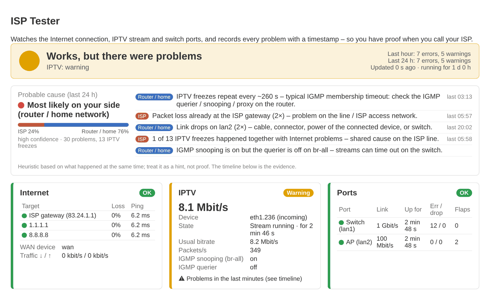
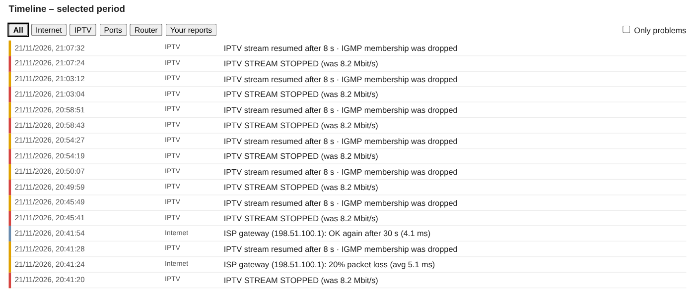

# luci-app-isp-tester

An OpenWrt package with a LuCI web interface that watches your Internet connection, IPTV stream and switch ports, and records every problem with a timestamp. It is built for intermittent faults like IPTV freezing at random times, so you have concrete logs when you talk to your ISP.

Target: **OpenWrt 24.10 and 25.12** (ucode + rpcd + LuCI JS). No compiled code, the package is architecture-independent.



## Screenshots

*Demo data: evening IPTV freezes every ~260 s, two short packet-loss bursts at the ISP gateway, and a flapping LAN port.*

**Probable cause.** The verdict is ISP vs. router/home, with the findings behind it:


**History, last 24 h.** It shows a state strip, ping with packet-loss bands, IPTV bitrate, WAN traffic and interface errors:


**Zoomed to one hour.** Here the freezes are clearly periodic:


**Timeline.** Click an event to zoom the charts to that moment:



## What it monitors

| Area | How | Logged events |
|------|-----|---------------|
| **Internet** | Ping results of **collectd** (luci-app-statistics, Ping plugin): loss, latency and jitter per host. The host netifd reports as gateway is marked as the ISP gateway | packet loss, high latency, high jitter (optional), host not responding, *Internet down* (no host responds), recovery with duration |
| **Optical signal** (SFP / ONT) | `ethtool -m <port>`: RX / TX power (dBm), module temperature, voltage, laser current and the module's alarm flags; only when the WAN goes through an SFP module and `ethtool` is installed | **no light** (RX at the noise floor), *optical signal weaker* (RX 3 dB below its usual level, or the module's own low-power warning), *SFP alarm*, *module does not answer*; RX / TX chart |
| **WAN session** | netifd status of the WAN interface | interface down/up (PPPoE/DHCP session lost), session restarted between two checks, WAN address changed |
| **IPv6** | netifd status of the DHCPv6 interface (`wan6`, what odhcp6c got) + the IPv6 hosts of the collectd Ping plugin | *IPv6 down* (no IPv6 host answers while IPv4 does), DHCPv6 session down/up, delegated **prefix lost / changed**, **no router advertisement** (default route gone) |
| **DNS** | dnsmasq's own statistics: `ubus call dnsmasq metrics` every interval, per upstream server from its SIGUSR1 dump in the system log (every 5 min) | **DNS failing** (≥ 10 % of the queries sent upstream unanswered within a minute) / *OK again*; *DNS server X: N of M queries retried or failed* |
| **System log** | `logread`: pppd, udhcpc, igmpproxy/mcproxy, kernel, dnsmasq | LCP echo timeouts, PPPoE discovery/authentication failures, DHCP lease lost, proxy errors, network driver hang, connection table full, out of memory, DNS query limit |
| **IPTV** | Bitrate of the IPTV VLAN (bridge per-VLAN counters), or of a device that carries only IPTV traffic (e.g. `eth1.387`, or the decoder's port measured outgoing) | stream started, **stream stopped**, stream resumed after *N s* (with what IGMP did meanwhile), **decoder switched off** (stream gone and no channel subscribed any more: logged as info, not a fault), stream lost (still subscribed: long outage), bitrate dip |
| **IGMP** | Joined groups on the proxy's upstream (`/proc/net/igmp`), multicast proxy process (igmpproxy, mcproxy, omcproxy), bridge MDB and IGMP timers | proxy stopped / restarted; every freeze is tagged as *channel change*, *membership dropped* or *still subscribed*; the operator's IGMP general queries (isp-tester-tsmon) | …, no query from the operator for 2 intervals |
| **IPTV picture quality** (optional) | The helper `isp-tester-tsmon` counts every packet of the incoming stream, continuously: MPEG-TS continuity errors (lost packets) of the channel being watched | **picture errors** (*N* lost-packet gaps, ~*M* packets, channel, longest pause); yellow for a while after errors |
| **Channel names** | Read from the stream itself (DVB SDT/PAT tables) by the same helper, or names set by hand | the channel being watched is named on the status page, in timeline events, the measurements CSV and notifications |
| **Ports** | `/sys/class/net/<dev>` counters and link state | link down/up, link flapping between samples, speed change (e.g. 1 Gbit → 100 Mbit), RX/TX/CRC errors, drops |
| **Router** | `/proc`: CPU per core (incl. softirq), RAM, connection tracking table. Only read to explain problems; for graphs use *Status → Realtime Graphs* or luci-app-statistics | router overloaded, low RAM, connection table full |
| **You** | **⚑ Problem now** button | your report with the time of the click and an optional note |
| **Gaps** | the collector's own sign of life (`alive.json`, once a minute) + the kernel's boot id and `/proc/uptime` | **router restarted** (up since …), **not measured from X to Y** (router restarted, monitoring off, collector stopped or blocked) – listed in the report |
| **Decoders** (bridged IPTV VLAN) | bridge MAC table (`bridge -s fdb`: which MAC behind which port, seconds since its last frame) + link of that port | *decoder restarted* (away N s; port link down / vanished from the MAC table / silent while the stream stopped), *switched off*, *back* – freezes during a restart are not counted against the ISP |
| **Path snapshot** | one `mtr -r` (when installed) or busybox `traceroute` when a loss starts or the WAN is down, at most every 10 min | *loss starts at hop N (IP) and carries on to the destination* – the hops fold out on the timeline and are in the report |
| **Bufferbloat** | collectd's ping matched with the WAN traffic of the same interval (device counters); line speed = highest 30 s rate seen or set | *bufferbloat: ping +N ms with the link X % full* / *over*; WAN traffic chart with the periods marked; card: ping idle vs. full link |
| **Second router** (optional) | Events of a router behind this one (access point with a decoder, phone, TV), sent over UDP | everything that router logs, on the same timeline marked with its name; *router stopped reporting* / *reports again* |

Optionally it shows whether **IGMP snooping** and the **querier** are active on a bridge, and which group goes to which bridge port (needs `ip-bridge`).

The package does not duplicate what OpenWrt already does: ping comes from collectd, the session from netifd, messages from the system log, persistence from a mounted USB folder. The own measurements are the IPTV bitrate, read from the interface counters every second (collectd's 30 s average would hide freezes), and the optional picture quality scan (nothing in OpenWrt counts lost IPTV packets).

### Ping via collectd

```sh
opkg install luci-app-statistics collectd-mod-ping collectd-mod-unixsock
```

In *Statistics → Setup → Network plugins → Ping* add the ISP gateway (the WAN gateway or PPPoE peer) and one or two far hosts (e.g. `1.1.1.1`, `8.8.8.8`), and for IPv6 one or two IPv6 hosts (e.g. `2606:4700:4700::1111`, `2001:4860:4860::8888`). Enable *UnixSock* in *General plugins* so the tester gets live values; without it, it reads the RRD files, which lag behind by the rrdtool cache time (minutes).

Gateway vs. far-target loss helps pinpoint the cause. Loss to the gateway points at the line or the ISP access network. Loss only to the far targets points further into the ISP's network.

## Web interface

**Services → ISP Tester → Overview**

- A large status banner: green "Everything works", yellow "Works, but there were problems" (within the last 15 min) or red "Fault right now".
- **Probable cause** panel for the selected period. It gives a verdict (*ISP*, *router / home network*, *mixed*), an ISP-vs-home ratio, and the findings behind it (see below).
- One card each for Internet, IPTV and Ports, with live values and the reason for any yellow or red state.
- **History** for up to 24 h: pick 1 h / 6 h / 24 h and move back and forward with ◀ ▶ (*Now* returns to live). A green/yellow/red state strip shows when things went wrong. The charts show ping with packet-loss bands, IPTV bitrate with stall bands, and interface errors. Hover a chart to see exact values. The last hour live uses 10 s samples; older data uses 1-minute aggregates (worst loss, minimum bitrate and summed errors are kept, so short glitches are not averaged away). The IPTV bitrate is measured on its own 1 s timer, so freezes of only a few seconds are logged with their exact start and length; the chart adds a *Lowest 1 s bitrate* line when a freeze is shorter than one chart point.
- A timeline of the selected period, filterable by area or "only problems". Click an event to zoom the charts to that moment.
- **When do problems happen**: problems per hour of the day. An evening peak points at an overloaded ISP network.
- **⚑ Problem now**: click it when the TV freezes or the Internet is slow. The mark goes on the timeline, and the analysis tells you whether the router measured anything at that moment. If not, the cause is probably the decoder, the TV, Wi-Fi, or the IPTV device is set wrong.
- **Report for the ISP**: a printable summary (measurement coverage, outages, freezes with total/longest duration, session drops, verdict, problems by hour, event log). Print it or save it as PDF and attach it to your complaint. The button asks for the period – the one shown in the charts or **chosen days** (within the last 24 h that the router keeps) – and the **hours of the day**, e.g. only *18–23* when the problem shows while you watch TV (presets: evening, 18–23, daytime; over midnight works too, e.g. 22–2). With hours chosen, everything counts only those hours: the summary, the assessment, the event list, the problems by hour and the coverage; an outage that started before 18:00 counts with its part after 18:00. The same dialog downloads the **timeline CSV of those days and hours**.
- **🔧 Working on the network**: before you re-plug cables, restart the switch or change settings, choose 15 / 30 / 60 / 120 min (with an optional note). Everything is still logged, but flagged: it is left out of the analysis, the report's counts and event list, the banner's error counts and the cards' "problems in the last minutes", and no notifications are sent – so your own work is not taken for an outage. A blue strip shows the time left (*+30 min*, *End now*); the state strip marks the period blue; the timeline shows those entries greyed with *maintenance*; the report lists the maintenance windows as excluded. It survives a collector restart (saving settings). Events the second router logs during its own maintenance arrive flagged too.
- Export buttons: measurements CSV (one row per interval) and timeline CSV.

**Services → ISP Tester → Settings** holds all thresholds, the IPTV VLAN (or device) and the list of ports. The ping hosts are set in collectd (luci-app-statistics).

The UI is in English and Polish.

## How the probable cause is decided

The panel looks at what happened **at the same time** (within 30 s) in the selected period:

| Observation | Points to |
|---|---|
| Packet loss already at the ISP gateway | ISP line / access network |
| Internet completely down while the WAN port keeps its link | ISP network |
| Loss only to far targets (2+ targets), gateway fine | ISP backbone / peering |
| Loss to a single far target only | that server (no weight) |
| WAN port loses link / has errors | line / ONT (counts half for both sides) |
| Received optical power fell or no light (SFP) | ISP line: fibre, connector, splitter (hard evidence) |
| Internet problems while the optical signal was weak or gone | the same cause, in the line |
| IPTV freeze together with Internet problems | ISP line |
| IPTV freeze together with a LAN port drop, error or speed downgrade | cable / switch at home |
| IPTV freezes at a regular interval (e.g. every ~125 s or ~260 s) | IGMP timeout, i.e. router configuration (querier / snooping / proxy) |
| IPTV freeze with nothing else happening, measured on the ISP VLAN | ISP multicast side (less often IGMP) |
| Lost packets (continuity errors) counted in the incoming IPTV stream | ISP IPTV / multicast side, not the home network |
| IPTV freeze with nothing else happening, measured on the decoder port | router (IGMP snooping / querier) |
| IPTV freeze while the router stayed subscribed to the channel | ISP multicast side |
| IPTV freeze that started with the IGMP membership being dropped | IGMP timeout on the router / switch |
| Freeze period matches the bridge's IGMP membership or query interval | IGMP timer, i.e. router configuration (stronger) |
| IPTV interruption with a different group after it | channel change: ignored |
| Stream gone and no channel subscribed for 15 s (`off_after`) | decoder switched off: not a fault, not counted |
| Multicast proxy stopped or restarted | router |
| PPPoE/DHCP session dropped while the WAN link stayed up | ISP |
| IPv6 down while IPv4 works, IPv6 prefix lost / changed, no router advertisement | ISP IPv6 |
| DNS failing while ping works | DNS server (ISP's, if you set it) |
| Problems while the router CPU / RAM / connection table was overloaded | router |
| Link full while you (a host at home) download or upload | your own traffic: named in the bufferbloat finding, no weight |
| Your "Problem now" reports with / without anything measured around them | context (no weight) |
| LAN link drops, CRC errors, renegotiation to 100 Mbit/s | cabling / devices at home |
| IGMP snooping on, querier off, no other querier elected (with freezes) | router configuration |
| IPTV freeze within 90 s of the IGMP querier passing from the ISP to the router | ISP (irregular queries); fix: block the ISP's queries |
| IPTV freeze while nobody asked on the IPTV VLAN | router configuration (querier off) |

Each finding is weighted (repeated occurrences count up to 5×). The verdict is "ISP" or "home" when one side has at least twice the weight of the other, otherwise "mixed". It is a hint, not proof. The timeline is the evidence you show the ISP.

## Data storage

Everything is kept in RAM in `/tmp/isp-tester/`, so flash is never written. The data survives a collector restart (e.g. after saving settings) but is lost on reboot, so download the CSVs before restarting the router.

To keep it across reboots, mount a USB stick (*System → Mount Points*) and set **Settings → General → Keep data on** to it (e.g. `/mnt/sda1`). `/tmp/isp-tester` then becomes a link to `<folder>/isp-tester`. If the stick is not mounted at start, the data stays in RAM. Do not point it at the internal flash. The current state (`state.json`) always stays in RAM in `/var/run/isp-tester/`.

### Reboots and gaps: "the router did not measure from X to Y"

A report with holes in it is easy for the ISP to dismiss, so the holes are named. Once a minute the collector writes `alive.json` (in the data folder, so on USB it survives a reboot) with the kernel's boot id. At start it compares:

- **another boot id** → *Router restarted – up since …* (from `/proc/uptime`) and *Not measured from <last sign of life> to <now>: the router restarted*;
- **same boot**, a pause longer than a few intervals → *Not measured …: monitoring was turned off* (the init script marks a clean stop) or *the collector stopped unexpectedly*;
- while running, a tick that came far too late → *… the collector was blocked*.

With the data in RAM nothing survives a reboot, so only *Router restarted* is logged. The state strip above the charts shows such periods hatched grey; outages and freezes that were open when the measurement stopped end there (their length does not include the time nobody measured). The report for the ISP starts with **Measurement coverage**: the share of the period that was measured, the router restarts, and every period without measurements with its reason.

### Watchdog: the monitor watches itself

A monitor that silently stops is worse than none. The init script uses procd's own instance watchdog: the collector reports to procd every interval (`ubus call service watchdog`); when the reports stop for six intervals (at least 60 s) – the collector hangs, e.g. in a command that never returns – procd kills it and starts it again. After a crash procd restarts it after 5 s, without giving up. The next start logs *Monitor restarted by the watchdog: it hung* or *… after it stopped unexpectedly*, and the time without measurements as a gap (above).

On the overview a red **MONITOR IS NOT WORKING** banner appears as soon as the collector has not updated its state for three intervals (with *Restart*), and a yellow strip when it restarted more than once in the last hour. The report counts the monitor restarts.

### DHCP of the decoders

Lease renewals and address changes from the operator. In a bridged IPTV VLAN (decoders get their address from the ISP) the lease is **not in the router** – dnsmasq does not hand it out and nothing about it reaches the system log, even though the traffic passes through the router. So the measuring helper `isp-tester-tsmon`, which listens on that VLAN anyway, also keeps the operator's DHCP replies (`-D`: unfragmented UDP 67 → 68 in its socket filter; OFFER, ACK with address, lease time and server, NAK) – a few packets an hour. When the router itself gives the decoders their address (routed IPTV), dnsmasq's `DHCPACK` / `DHCPNAK` lines in the system log are used for the decoders named in *Decoder names*.

Logged: *address X from the operator (lease 1 h)* the first time, *asked for an address from scratch* (an OFFER before the ACK: restarted or lost its lease), **address CHANGED X → Y**, **the operator REFUSED its lease (DHCPNAK)**, *renewed N after it had run out*, *lease ran out without a renewal* (decoder still there). Renewals are counted, not logged. The IPTV card shows *DHCP TV: 10.236.0.50 · lease 1 h · renewed 12 min ago · 7 renewals*; the analysis puts address changes and refused / expired leases on the operator's DHCP. *Settings → Decoders → DHCP of the decoders* turns it off.

### The tester's own load

Proof that the measurement does not load the router (and is not what breaks IPTV): under the banner's times a small line shows *Tester itself: CPU 0.3 % · RAM 4.1 MB* – the share of the router's **whole** CPU (all cores) used by the collector (including the commands it runs: logread, bridge, rrdtool) and by tsmon, from `/proc/<pid>/stat` and `status`. Hover it for now / average / maximum of each. The report says the same in one row (*Load of the tester itself*), and the 1-min history keeps its maximum.

### Clock: times are only worth something when it is synchronized

After a reboot the router starts with the time of its newest file until NTP sets the clock, so the first entries of a boot can carry a wrong time – exactly the entries the ISP would look at after an outage. Two sources, nothing measured twice:

- **What the NTP client reports**: `/etc/hotplug.d/ntp/90-isp-tester` notes every hotplug *ntp* event of busybox `ntpd` (stratum, step, unsync, periodic) or chrony. Logged: *clock synchronized (stratum N)*, *clock not synchronized any more*, *no NTP client running*.
- **The clock itself**: when wall time minus monotonic time jumps by more than 2 s, *Clock set by +N s* is logged.

Entries logged shortly after a boot while the clock was not confirmed are marked; when NTP sets the clock they are **moved by the step** (with the chart points of that time) and only then final – the timeline says *N earlier entries of this boot moved to the right time*. Confirmed without a step, they were right; after an hour without either they stay as they are. A yellow strip under the banner warns while the clock is not synchronized, and the report names the clock state and any steps in the period.

On install the package restarts `sysntpd` once (busybox ntpd reports to hotplug only when its state changes), so the current state is known at once.

## Sending the data to another device

The router keeps only the last 24 hours (and in RAM, nothing across a reboot). For a longer history the data can be sent to another device in your network – a PC, a NAS, a Raspberry Pi – over SSH, with dropbear's own client (`dbclient`, part of every OpenWrt image; no extra package).

*Settings → Send data to another device*:

1. Set the **address**, **user**, **port** and the **folder** on that device (a relative path is in the user's home), choose how often to send (hour, 6 hours, day, week), turn on *Send regularly* and **Save & Apply**.
2. **Show the public key** (the key pair is made on first use, in `/etc/dropbear/isp_tester_push_key`, which survives a firmware upgrade) and add it to `~/.ssh/authorized_keys` of that user on the other device.
3. **Test the login**, then **Send now**. The first login trusts the other device's host key; a changed key is refused afterwards.

Each transfer is one `isp-tester-<router>-<date>-<time>.tar.gz` with the timeline, the history, the CSV measurements, the channel names and the highest WAN rate. It is written under a temporary name and renamed at the end, so a cut connection never leaves a broken file. A failed try is repeated after 30 minutes; the last result is shown in the settings and the failure is also in the system log (`logread | grep isp-tester`). The script is `/usr/share/isp-tester/push.sh` (`send`, `test`, `pubkey`; settings in `uci show isp_tester.push`).

The report for the ISP and the CSV export on the overview cover what the router has (24 h); for a longer period unpack the files from the other device.

## Decoder restarts

A decoder that restarts makes the picture stop just like a stream the ISP stopped sending. To tell them apart, the collector watches the decoders themselves. In a bridged IPTV VLAN the decoders get their address from the ISP, so the router has no neighbour (ARP) entry for them; it reads the bridge's MAC table instead: every MAC learned in the IPTV VLAN on a port other than the one towards the ISP is a decoder (found automatically; names can be set in *Settings → Decoders*).

| Signal | When it works |
|---|---|
| **Port link down** | decoder plugged directly into this router's port |
| **Vanished from the MAC table** and came back | the entry is flushed on a link change and ages out after 5 min of silence |
| **Silent** for *Silent for* (40 s) **while the stream stopped**, then frames again | decoder behind a switch: its port on this router stays up |

Back within *Switched off after* (10 min): **decoder restarted**, with how long it was away and which signal saw it. Longer: *switched off or unplugged*, then *back*. The IPTV card lists the decoders with their port and state.

The analysis and the report put IPTV freezes during a decoder restart aside (*N freezes happened while decoder X restarted*), so they do not count against the ISP; repeated restarts point at the decoder (power supply, firmware, heat).

With a second router: a decoder plugged into the second router is best watched there (its port link is the clearest signal) – its restarts reach the main router's timeline and analysis.

## IPv6: IPv4 works, IPv6 does not

A common fault that looks like "the Internet is slow": IPv6 breaks while IPv4 keeps working. Browsers try IPv6 first and fall back to IPv4 only after a delay, so pages hang for a moment instead of failing. Nothing is measured twice for it:

- **What odhcp6c got**, from netifd (`ubus call network.interface.wan6 status`): the DHCPv6 session, the delegated prefix (*ipv6-prefix*, what the LAN addresses come from) and the IPv6 default route, which comes from the ISP's router advertisement. Logged: *IPv6 interface down / up*, **prefix lost** (the home network has no IPv6) and *back*, **prefix changed** (devices renumber, open IPv6 connections break), **no router advertisement** for *No router advertisement after* (60 s) and *back*. Only what was seen once is missed, so an ISP without IPv6 is not a fault. The interface is `wan6`, or `wan_6` when IPv6 is set to automatic on `wan` (*Settings → Internet → IPv6 interface* to choose another).
- **IPv6 ping**: the IPv6 hosts of the collectd Ping plugin are targets like the IPv4 ones (chart, CSV), but judged on their own: when all IPv6 hosts fail while an IPv4 host answers, **IPv6 down** is logged (a fault) and *IPv6 works again after N* when one answers. *Internet down* needs every IPv4 host to fail, so a dead IPv6 does not look like a total outage. The path snapshot traces an IPv6 host with `mtr` (or `traceroute6`).
- odhcp6c messages in the system log (no answer, no prefix available) are logged as *DHCPv6* events.

The Internet card shows *IPv6: prefix …/56 · RA OK · ping 2/2*; the analysis puts IPv6 faults on the ISP side, and the report counts IPv6 outages with their total and longest time.

## DNS (dnsmasq)

"Pages do not open but ping works" is often DNS. There is no own resolver test; dnsmasq already counts everything:

- **Every interval**, `ubus call dnsmasq metrics`: queries sent upstream (`dns_queries_forwarded`), answered from the cache or locally, and `dns_unanswered` (sent upstream, but no server answered in time). When at least *Unanswered for a warning* (10 %) of the queries sent upstream within a minute stay unanswered (and at least 5 were sent), **DNS failing** is logged; it ends when the share falls below half of that.
- **Per upstream server**, every 5 min (*Per-server statistics*): `kill -USR1` makes dnsmasq write its statistics to the system log (`server 1.1.1.1#53: queries sent 120, retried 3, failed 0, nxdomain replies 4, avg. latency 18ms`), which the collector reads with the rest of the log. *Retried* is a query that got no answer in time, *failed* a SERVFAIL/REFUSED. A server with 10 % or more of them since the previous dump is logged as *DNS server X: N of M queries retried or failed*. Each dump adds a few lines to the system log; set it to *Off* to avoid that. While dnsmasq logs every query (*Log queries* in Network → DHCP and DNS) the dump is not asked for: dnsmasq would then write its whole cache to the log too.

The Internet card shows *DNS: 85 queries/min · 60 % from the cache · 0 % unanswered · 1.1.1.1 18 ms*. The analysis puts DNS failures while the line works on the upstream DNS server (the ISP's, or the one you set); during an outage they are just part of it.

## Path snapshot at a loss

When a target starts losing packets (or everything is down), the collector runs one traceroute to a far target – the gateway alone would show nothing beyond hop 1. `mtr` (package `mtr`, 10 rounds at 0.5 s) is used when installed and gives loss per hop; otherwise busybox `traceroute -q 3`. The result is one event on the timeline: click it to fold out the hops.

How to read it: a loss that **starts at a hop and carries on to the destination** is where packets are lost – the event names that hop and the last good one before it. Loss at a single hop that does not continue is only a router answering pings slowly (ICMP rate limiting) and is ignored. If the destination shows no loss any more, the loss was already over when the snapshot ran (collectd reports per its interval, so the snapshot comes some seconds after the start; the event says how long after).

The report for the ISP lists every snapshot with its hop table. At most one per *At most every* (default 10 min), one at a time, stopped after 60 s.

## Bufferbloat: lags only when the link is full?

No speed test of its own: every collectd ping value (one average per collectd interval) is matched with the WAN traffic of the same interval, read from the WAN device's counters every tick. The line's speed is the highest 30-second rate ever seen (slowly forgotten, kept in `wanpeak.json`), or the speed of your plan when set (*Settings → Internet*).

- Ping at a load below 20 % is the base (median of the last 60 such values).
- Ping at a load of *Link full from* (70 %) or more that is *Ping increase* (30 ms) above the base, twice in a row, logs **bufferbloat** with the base, the ping, the load and the direction; two normal values end it.
- The Internet card shows *Ping idle / full link* – e.g. *10 ms / 80 ms (+70 ms) – lags only when the link is full* – and the line speed it uses. The chart *WAN traffic* marks the periods in yellow.
- The analysis puts it on the home side: your own traffic fills a buffer (modem or ISP). High-ping warnings during those periods are not counted against the ISP (loss still is). SQM (`luci-app-sqm`, cake, set a bit below the line speed) fixes it.

The load is known only when the link was full at least once (or the speed is set); until then the card says so.

## Optical signal of the SFP / ONT

If the WAN goes through an SFP module (or an ONT stick in an SFP cage) the router can read the module's own measurements, and the received power is the one number that says whether the light from the line got weaker – a ping cannot. It is read with `ethtool -m <port>` (package `ethtool`) every 30 s – the EEPROM is slow – and shown as *Optical signal: RX -9.1 dBm · TX 2.4 dBm · 45 °C* on the Internet card, with a chart of both powers.

- **No light** (RX at −40 dBm or the module reports −inf, two readings in a row): the fibre is broken or unplugged, a connector is loose, or the ISP's side is down. A fault, with the time it started.
- **Optical signal weaker**: RX is *Weaker signal from* (3 dB) below its usual level (the median of the last 20 readings, frozen during the drop), or below *Received power below* when set, or the module raises its own low-power warning. Two readings in a row. Ends when the level is back, with the weakest value.
- **SFP module alarm**: the module's other alarm / warning flags (temperature, laser current, voltage, TX power, RX too strong).
- **Module does not answer** after it did (taken out, or hung).

The analysis counts a fall of the light, and Internet problems that happen during it, for the ISP's side – clean and re-seat the connector first, then show the log. Without a module `ethtool -m` fails and nothing is shown (it is tried again every 10 minutes); set *SFP port* when the module sits on a port other than the WAN's. The port is the physical device of the WAN interface without the VLAN (`eth1.835` → `eth1`).

> Written from the `ethtool -m` output format (`Laser output power`, `Receiver signal average optical power`, `Module temperature`, the `… alarm` / `… warning` flags); not tried on a real module yet. Check on the router: `ethtool -m <port>`.

### IGMP queries from the ISP

The operator's router keeps the IPTV memberships alive with an IGMP *general query* (about every 125 s) that the decoders answer. When the queries stop, the memberships expire after about two intervals (≈ 260 s) and the stream freezes – repeatedly, so it looks random. The *IGMP timers* row only shows this router's **bridge settings**; it says nothing about what the operator sends. This is measured separately.

`isp-tester-tsmon -Q` notes the general queries (IGMPv1/v2/v3) on the port facing the ISP (needs *Measure incoming traffic*; on a decoder's port nothing is seen). The *ISP IGMP queries* row of the IPTV card shows *last query 41 s ago · every ~125 s · 10.1.0.1 (IGMPv2)*. When more than two intervals (plus the response time) pass without one, a warning event *No IGMP query from the operator for 4 min* is logged (dated from when the memberships began to expire), and *queries from the operator again after …* when they return. The interval is the median of the gaps seen (else the query's own interval, else 125 s). Freezes inside such a silence are named in the analysis as an ISP-side fault; if no query is seen at all for more than 5 min while freezes happen, the analysis says so (check that the capture port faces the ISP). It warns about a *stop* only after queries were seen before. Without *Identify channel names* / *Picture quality* the helper runs queries-only (`-I`) and does not look at the streams.

*Settings → IPTV → Watch the operator's IGMP queries* (`iptv.igmp_query`). Needs the `isp-tester-tsmon` package; rebuild it for `-Q`/`-I`.

### Who asks: the ISP or the router (IGMP querier)

On a bridged IPTV VLAN two devices can send the queries: the ISP, and this router's bridge (its querier, e.g. switched on with `bridge vlan global set vid 236 dev br-lan mcast_querier 1`). The bridge elects one – its own queries go out from `0.0.0.0`, so the ISP always wins – and stays silent while the elected one keeps asking. When the ISP stops, the bridge waits its *other querier present* interval (255 s) before it asks itself. The ISP may let the channel expire meanwhile: the picture stops for up to a minute although the decoder still watches and the router is still subscribed.

The IPTV card shows who asks now (*Asks now: the ISP · 10.206.86.1 (eth1)* / *this router* / *nobody*), read every interval from the kernel (`bridge -d vlan global show`, `mcast_querier_state_ipv4`). Every hand-over is a timeline event (*IGMP querier of VLAN 236: the ISP → this router · no query from the ISP for 4 min 15 s*), and *NO IGMP querier* is a warning. A freeze within 90 s of a hand-over from the ISP to the router is a finding of its own (ISP side, with the fix below). With per-VLAN snooping the card and the analysis use the VLAN's own snooping / querier / timers, not the bridge-wide ones.

*Settings → IPTV → IGMP querier* (section `querier`, off by default) lets the collector keep it set up, instead of a hotplug script:

- **Set up the querier** (`enabled`): per-VLAN snooping on the bridge, the router's querier in the IPTV VLAN (IGMP version `igmp_version`), the port towards the ISP a permanent multicast router port (the decoders' reports go to the ISP) and, with `others_off`, no snooping in the bridge's other VLANs. Checked every minute and at once when the kernel shows something else (network restart). Switching it off leaves the bridge as it is. Remove an old hotplug script that does the same.
- **Block the ISP's IGMP queries** (`block_isp`, needs `kmod-nft-bridge`): the nftables table `bridge isp_tester` drops the ISP's general queries (to 224.0.0.1) arriving on the port towards the ISP, so the router stays the only querier and asks every 125 s. The decoders' answers still reach the ISP. The rule matches by offsets from the Ethernet header, so it works whether the network card strips the VLAN tag or not. `isp-tester-tsmon` still sees the dropped queries (*ISP IGMP queries* keeps working). The card shows how many were dropped; if the ISP is still elected more than 255 s after the filter was set, it warns that the filter does not catch them.

```sh
opkg install kmod-nft-bridge
nft list table bridge isp_tester        # the rule and its counter
nft delete table bridge isp_tester      # by hand, e.g. after removing the package
```

## Two routers, one timeline

When the decoder, the phone or the TV sit behind a second router (e.g. an access point on a LAN port of the main router), each router only sees itself: the main one sees the ISP, the second one sees the devices. Install the package on both and let the second one send its events to the main one:

1. On the main router: *Settings → Second router → This router: Receives the events of a second router*, set a key (at least 8 characters).
2. On the second router: *Sends its events to the main router*, the main router's IPv4 address and the same key.

What you get on the main router:

- Every event of the second router appears on the timeline with its name in front (*M477S · Ports: lan1 link DOWN*). The timeline can be filtered by router; the report for the ISP includes them.
- A card shows the second router's state (its ports and IPTV), refreshed every interval. If it stops reporting for a minute (off, rebooting, the cable between the routers), that is logged and the banner turns yellow.
- The analysis uses its ports and your reports there as evidence for the home side, and points out IPTV freezes that the second router saw but the main router (nearer the ISP) did not: the stream was lost between the routers.
- Notifications of the main router include the second router's events.

How it works: UDP (default port 51477), one JSON message per datagram, signed with HMAC-SHA256 of the shared key; messages with another key are ignored and counted. The receiver confirms what it stored; anything unconfirmed is sent again every interval (up to 300 events are kept), so a short outage of the main router loses nothing. If the second router's clock is off by more than 5 s, its events are moved to the main router's time. The LAN zone of the default firewall accepts the port; if the second router is in another zone, open UDP 51477 on the main router for it. Only IPv4 addresses are used, so nothing needs to be resolved at boot.

## Notifications

**Settings → Notifications** sends a push message when something breaks and when it is fixed: [ntfy](https://ntfy.sh) (topic URL), a Telegram bot (token + chat id) or any webhook (JSON POST `{"text": …}`). Events are batched (default at most one message per 5 min). Messages that cannot be sent during an outage are sent when the Internet is back. Messages are in English or Polish. It uses `uclient-fetch` (part of OpenWrt) with HTTPS support. The address holds the secret (the bot token, the ntfy topic), and a command line can be read by every process on the router: with `ucode-mod-uclient` installed (`opkg install ucode-mod-uclient`, where the release has it) the message is sent from inside the collector instead, so the address appears in no command line; without it, or if the module refuses, `uclient-fetch` is used as before (the message itself goes in a file, not in the command line).

| File | Content |
|------|---------|
| `/var/run/isp-tester/state.json` | current health + last hour of 10 s samples (always RAM) |
| `history.json` | 24 h of 1-minute aggregates for the history view |
| `events.json` | timeline (ring buffer, default 1000 entries) |
| `samples.csv` | one row per interval (ring buffer, default 8640 rows = 24 h at 10 s) |
| `samples.prev.csv` | previous CSV after the column layout changed (config change) |
| `wanpeak.json` | highest WAN rate seen (line speed for the bufferbloat check) |
| `/var/run/isp-tester/peers.json` | receiver: last event number stored per second router (always RAM) |
| `/tmp/isp-tester/alive.json` | last sign of life of the collector and the boot id (once a minute) |
| `/var/run/isp-tester/ntp.last`, `ntp.pending` | what the NTP client reported (hotplug), newest / not read yet (always RAM) |

## Choosing what to measure IPTV on

**Simplest: enter the IPTV VLAN** (Settings → IPTV → *IPTV VLAN*, e.g. `387`). This is meant for the common setup where the ISP's IPTV VLAN is only bridged to the decoders (they get their address from the ISP) and the router has no `eth1.387` / `br-lan.387` device:

- the bridge, the port towards the ISP (e.g. `eth1`) and the decoder ports (e.g. `lan1`, `lan2`) are found from `bridge vlan show`;
- the bitrate comes from the bridge's per-VLAN counters (`bridge -s vlan show vid 387`). The kernel keeps them off by default, so the collector switches them on (`vlan_stats_enabled=1`, same as `ip link set br-lan type bridge vlan_stats_enabled 1`);
- the channels come from the bridge's multicast table (`bridge mdb`), shown per port, i.e. per decoder;
- link drops and errors of the ISP port count for the IPTV card.

One router is enough: decoders behind a second router/AP that only bridges the VLAN are seen through the port that leads to it (their IGMP joins pass through when snooping is off there). Only errors on the last cable behind that router are not visible.

Without a VLAN (under *Advanced*) you choose a device where **only IPTV** flows:

- **VLAN subinterface** from the ISP (e.g. `eth1.387`). Use *direction: incoming*.
- **Port towards the decoder**. Use *direction: outgoing*. This only works if nothing else uses that port.

Switch the TV on and check that the overview shows a few Mbit/s. Then set *stream threshold* below the lowest normal bitrate (default 500 kbit/s).

## IPTV picture quality (optional)

A freeze is only half of what goes wrong with IPTV: more often the picture breaks into blocks for a moment because a few packets were lost. The bitrate hardly changes then, so the bitrate monitor does not see it. The quality measurement counts the lost packets directly: every MPEG-TS packet carries a 4-bit continuity counter per stream, and a gap in it means packets are missing. Nothing is decoded, so it works on scrambled streams too.

Enable it in Settings → IPTV → *Picture quality*. It needs the package **`isp-tester-tsmon`** (see [Install](#install)); without it the IPTV card says so.

How it works, and what it costs:

- A small helper written in C (`/usr/sbin/isp-tester-tsmon`) listens on the ISP-side port of the IPTV VLAN, or on the configured device. The kernel filters the packets (only that VLAN, UDP multicast), so everything else, such as Internet traffic, never reaches it.
- It counts **every packet, all the time**, as it arrives: continuity errors, transport error flags, RTP gaps and pauses. Nothing is stored and no file is written except a small status file in RAM once a second. A HD stream is about 1000 packets/s and the work per packet is a few counter checks, so it is light even on small routers (`top` shows it after enabling).
- The collector reads the counters every interval. The thresholds count the errors **of the last minute**, so short glitches that happen once an hour or less are caught too, which short sampled captures would usually miss.
- If the router itself is too busy to take every packet (its socket buffer overflows), those packets are reported as *not counted*, and errors at that time are not logged as the ISP's fault.
- The channel being watched is the multicast group that carries TS, so channel changes need no setting and the log names the group. EPG/service groups are ignored. A second decoder on another channel is reported separately.
- Events are limited by the same cooldown as port errors; errors held back by it are added to the next event.
- It measures the stream **as it arrives at the router**, so lost packets found here come from the ISP side. Measured on the decoder port (direction *outgoing*), the result is only informational in the analysis.
- The helper is started by the collector, ends with it, and is restarted (with a growing pause) if it stops.

Thresholds (Settings → IPTV → Advanced): *Warn from* / *Fault from* count lost-packet gaps per minute (default 1 and 30), *Pause warning* flags a stream that pauses for that many ms (default 500).

## IPTV channel names

The status page, the timeline, the CSV and notifications name the channel being watched (*TVP 1 HD (239.1.1.1)*) instead of only its multicast group. The name comes from the stream: every DVB stream carries a Service Description Table with the service and provider name, and a PAT that says which service the stream is. Both are sent in the clear about every 1–2 s, also on encrypted channels.

- The same helper as the picture quality reads them from every channel that flows, so a new channel is named within a few seconds and known channels cost nothing extra. It runs for names alone too, when the picture quality is off.
- Learned names are kept in `channels.json` next to the timeline (so with *Keep data on* a USB folder they survive a reboot). Settings → *Names read from the streams* lists them and can forget them.
- Some operators send no names. Then the IPTV card says so, and names can be set by hand in Settings → *IPTV channel names* (multicast group → name); those always win.
- Text in DVB's own character sets (ISO 6937, ISO 8859-x, UTF-8, UCS-2) is converted to UTF-8, so Polish letters show correctly.
- Needs `isp-tester-tsmon`; can be switched off with *Identify channel names*.

## Install

### Package (recommended)

Ready-made packages are attached to every [release](https://github.com/matt400/luci-app-isp-tester/releases). `luci-app-isp-tester` is architecture-independent, so the same file works on every router. The helper for the picture quality and channel names, `isp-tester-tsmon`, is compiled, so there is one file per architecture: `isp-tester-tsmon_<arch>`, where `<arch>` is `OPENWRT_ARCH` from `/etc/os-release` (the commands below pick it automatically). Released architectures: `aarch64_cortex-a53`, `aarch64_cortex-a72`, `aarch64_generic`, `arm_cortex-a7_neon-vfpv4`, `arm_cortex-a9_vfpv3-d16`, `arm_cortex-a15_neon-vfpv4`, `mipsel_24kc`, `mips_24kc`, `x86_64`. For another one, build it yourself (below); everything else works without it.

**OpenWrt 24.10 (opkg):**

```sh
opkg update
opkg install https://github.com/matt400/luci-app-isp-tester/releases/latest/download/luci-app-isp-tester.ipk
# picture quality and channel names (optional, per architecture)
. /etc/os-release
opkg install https://github.com/matt400/luci-app-isp-tester/releases/latest/download/isp-tester-tsmon_${OPENWRT_ARCH}.ipk
# Polish translation (optional)
opkg install https://github.com/matt400/luci-app-isp-tester/releases/latest/download/luci-i18n-isp-tester-pl.ipk
```

**OpenWrt 25.12 and newer (apk):**

```sh
apk update
wget -O /tmp/isp-tester.apk https://github.com/matt400/luci-app-isp-tester/releases/latest/download/luci-app-isp-tester.apk
apk add --allow-untrusted /tmp/isp-tester.apk
# picture quality and channel names (optional, per architecture)
. /etc/os-release
wget -O /tmp/isp-tester-tsmon.apk https://github.com/matt400/luci-app-isp-tester/releases/latest/download/isp-tester-tsmon_${OPENWRT_ARCH}.apk
apk add --allow-untrusted /tmp/isp-tester-tsmon.apk
# Polish translation (optional)
wget -O /tmp/isp-tester-pl.apk https://github.com/matt400/luci-app-isp-tester/releases/latest/download/luci-i18n-isp-tester-pl.apk
apk add --allow-untrusted /tmp/isp-tester-pl.apk
```

`--allow-untrusted` is needed because the package is not signed with an OpenWrt key.

### Build it yourself

In the OpenWrt SDK:

```sh
git clone https://github.com/matt400/luci-app-isp-tester package/luci-app-isp-tester
./scripts/feeds update -a && ./scripts/feeds install -a
make package/luci-app-isp-tester/compile V=s
# the helper: its own package in tsmon/
cp -r package/luci-app-isp-tester/tsmon package/isp-tester-tsmon
make package/isp-tester-tsmon/compile V=s
```

The packages end up in `bin/packages/*/base/`.

### Making a release

Push a tag like `v0.2.0`. GitHub Actions builds the `.ipk` (24.10) and `.apk` (25.12), the helper for each architecture listed above, and attaches them to the release. The version is taken from the tag.

### Quick test (copy files)

```sh
ROUTER=root@192.168.1.1
ssh $ROUTER 'opkg update && opkg install ucode-mod-fs ucode-mod-uloop ucode-mod-uci ucode-mod-ubus ucode-mod-socket ucode-mod-digest rpcd-mod-ucode ip-bridge'
scp -O -r root/* $ROUTER:/
scp -O -r htdocs/luci-static/resources/* $ROUTER:/www/luci-static/resources/
ssh $ROUTER 'chmod +x /etc/init.d/isp_tester && sh /etc/uci-defaults/80_luci-isp-tester'
```

This overwrites `/etc/config/isp_tester` and installs no translations. The helper is not included; build it with the SDK (or for a quick try with the toolchain: `$CC -O2 -o isp-tester-tsmon tsmon/src/tsmon.c`) and copy it to `/usr/sbin/`.

## Command line

```sh
/etc/init.d/isp_tester restart
logread -e isp-tester                 # collector errors
ubus call luci.isp_tester status
ubus call luci.isp_tester events '{"limit":20}'
```

## Development / testing off-device

The collector can run on any Linux machine with ucode (and the uloop module) against fake sysfs data:

```sh
ISP_TESTER_RUNDIR=/tmp/t/run ISP_TESTER_SYSNET=/tmp/t/sys \
ISP_TESTER_CONFIG=/tmp/t/cfg.json ISP_TESTER_VARDIR=/tmp/t/var \
ISP_TESTER_ROUTE=/tmp/t/route ucode root/usr/share/isp-tester/collector.uc
```

Further overrides: `ISP_TESTER_VARDIR`, `ISP_TESTER_PROC` (fake `/proc` with `stat`, `meminfo`, `net/igmp`, `<pid>/comm` …), `ISP_TESTER_WANSTATUS` (JSON file instead of `ubus call network.interface.wan status`), `ISP_TESTER_LOGREAD`, `ISP_TESTER_RRDTOOL`, `ISP_TESTER_FETCH`, `ISP_TESTER_BRIDGE`, and `ISP_TESTER_TSMON` (path of the helper; built with `cc -O2 -o tsmon tsmon/src/tsmon.c` it runs on any Linux, e.g. on `lo`, needs root). The helper also reads a capture: `isp-tester-tsmon -r capture.pcap` prints the same counters and names as JSON, handy to check a `tcpdump -w` recording from the router. Ping data comes from `wan.collectd_socket` (a collectd unixsock, e.g. a small test server) or `wan.rrd_dir` in the JSON config.

`ISP_TESTER_CONFIG` is a JSON file with the same keys as the UCI config (see `default_config()` in the collector).

## License

Apache-2.0
