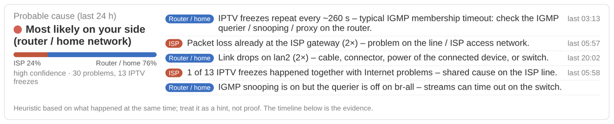
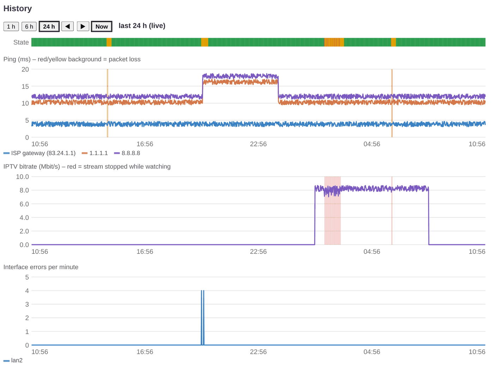
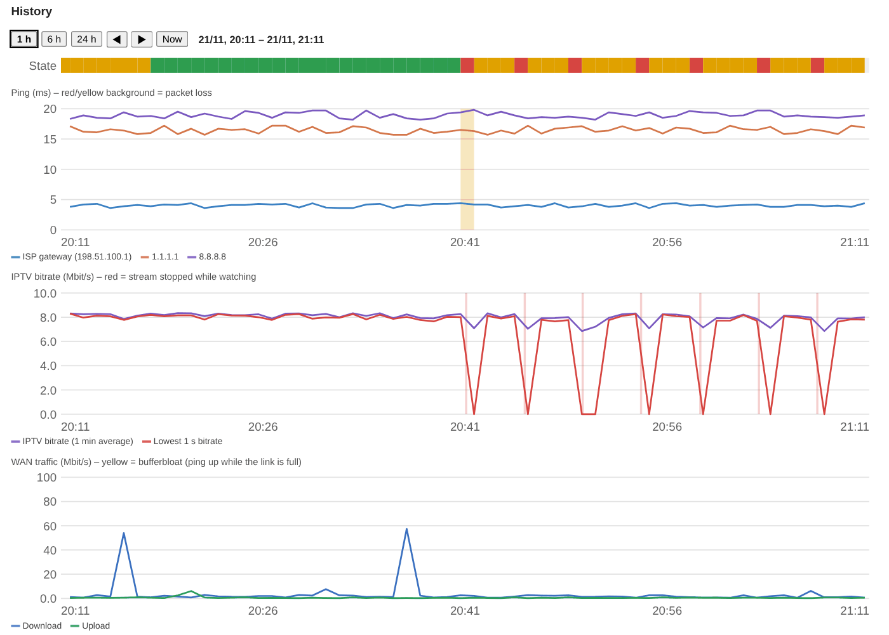

# luci-app-isp-tester

An OpenWrt package with a LuCI web interface that watches your Internet connection, IPTV stream and switch ports, and records every problem with a timestamp. It is built for intermittent faults like IPTV freezing at random times, so you have concrete logs when you talk to your ISP.

Target: **OpenWrt 24.10 and 25.12** (ucode + rpcd + LuCI JS). No compiled code, the package is architecture-independent.


## Screenshots

*Demo data: evening IPTV freezes every ~260 s, two short packet-loss bursts at the ISP gateway, and a flapping LAN port.*

**Probable cause.** The verdict is ISP vs. router/home, with the findings behind it:



**History, last 24 h.** It shows a state strip, ping with packet-loss bands, IPTV bitrate and interface errors:



**Zoomed to one hour.** Here the freezes are clearly periodic:



**Timeline.** Click an event to zoom the charts to that moment:


## What it monitors

| Area | How | Logged events |
|------|-----|---------------|
| **Internet** | Ping results of **collectd** (luci-app-statistics, Ping plugin): loss, latency and jitter per host. The host netifd reports as gateway is marked as the ISP gateway | packet loss, high latency, high jitter (optional), host not responding, *Internet down* (no host responds), recovery with duration |
| **WAN session** | netifd status of the WAN interface | interface down/up (PPPoE/DHCP session lost), session restarted between two checks, WAN address changed |
| **System log** | `logread`: pppd, udhcpc, igmpproxy/mcproxy, kernel, dnsmasq | LCP echo timeouts, PPPoE discovery/authentication failures, DHCP lease lost, proxy errors, network driver hang, connection table full, out of memory, DNS query limit |
| **IPTV** | Bitrate of the IPTV VLAN (bridge per-VLAN counters), or of a device that carries only IPTV traffic (e.g. `eth1.236`, or the decoder's port measured outgoing) | stream started, **stream stopped**, stream resumed after *N s* (with what IGMP did meanwhile), stream lost (decoder off or long outage), bitrate dip |
| **IGMP** | Joined groups on the proxy's upstream (`/proc/net/igmp`), multicast proxy process (igmpproxy, mcproxy, omcproxy), bridge MDB and IGMP timers | proxy stopped / restarted; every freeze is tagged as *channel change*, *membership dropped* or *still subscribed* |
| **Ports** | `/sys/class/net/<dev>` counters and link state | link down/up, link flapping between samples, speed change (e.g. 1 Gbit → 100 Mbit), RX/TX/CRC errors, drops |
| **Router** | `/proc`: CPU per core (incl. softirq), RAM, connection tracking table. Only read to explain problems; for graphs use *Status → Realtime Graphs* or luci-app-statistics | router overloaded, low RAM, connection table full |
| **You** | **⚑ Problem now** button | your report with the time of the click and an optional note |

Optionally it shows whether **IGMP snooping** and the **querier** are active on a bridge, and which group goes to which bridge port (needs `ip-bridge`).

The package does not duplicate what OpenWrt already does: ping comes from collectd, the session from netifd, messages from the system log, persistence from a mounted USB folder. The only own measurement is the IPTV bitrate, read from the interface counters every second (collectd's 30 s average would hide freezes).

### Ping via collectd

```sh
opkg install luci-app-statistics collectd-mod-ping collectd-mod-unixsock
```

In *Statistics → Setup → Network plugins → Ping* add the ISP gateway (the WAN gateway or PPPoE peer) and one or two far hosts (e.g. `1.1.1.1`, `8.8.8.8`). Enable *UnixSock* in *General plugins* so the tester gets live values; without it, it reads the RRD files, which lag behind by the rrdtool cache time (minutes).

Gateway vs. far-target loss helps pinpoint the cause. Loss to the gateway points at the line or the ISP access network. Loss only to the far targets points further into the ISP's network.

## Web interface

**Status → ISP Tester → Overview**

- A large status banner: green "Everything works", yellow "Works, but there were problems" (within the last 15 min) or red "Fault right now".
- **Probable cause** panel for the selected period. It gives a verdict (*ISP*, *router / home network*, *mixed*), an ISP-vs-home ratio, and the findings behind it (see below).
- One card each for Internet, IPTV and Ports, with live values and the reason for any yellow or red state.
- **History** for up to 24 h: pick 1 h / 6 h / 24 h and move back and forward with ◀ ▶ (*Now* returns to live). A green/yellow/red state strip shows when things went wrong. The charts show ping with packet-loss bands, IPTV bitrate with stall bands, and interface errors. Hover a chart to see exact values. The last hour live uses 10 s samples; older data uses 1-minute aggregates (worst loss, minimum bitrate and summed errors are kept, so short glitches are not averaged away). The IPTV bitrate is measured on its own 1 s timer, so freezes of only a few seconds are logged with their exact start and length; the chart adds a *Lowest 1 s bitrate* line when a freeze is shorter than one chart point.
- A timeline of the selected period, filterable by area or "only problems". Click an event to zoom the charts to that moment.
- **When do problems happen**: problems per hour of the day. An evening peak points at an overloaded ISP network.
- **⚑ Problem now**: click it when the TV freezes or the Internet is slow. The mark goes on the timeline, and the analysis tells you whether the router measured anything at that moment. If not, the cause is probably the decoder, the TV, Wi-Fi, or the IPTV device is set wrong.
- **Report for the ISP**: a printable summary of the selected period (outages, freezes with total/longest duration, session drops, verdict, problems by hour, event log). Print it or save it as PDF and attach it to your complaint.
- Export buttons: measurements CSV (one row per interval) and timeline CSV.

**Status → ISP Tester → Settings** holds all thresholds, the IPTV VLAN (or device) and the list of ports. The ping hosts are set in collectd (luci-app-statistics).

The UI is in English and Polish.

## How the probable cause is decided

The panel looks at what happened **at the same time** (within 30 s) in the selected period:

| Observation | Points to |
|---|---|
| Packet loss already at the ISP gateway | ISP line / access network |
| Internet completely down while the WAN port keeps its link | ISP network |
| Loss only to far targets (2+ targets), gateway fine | ISP backbone / peering |
| Loss to a single far target only | that server (no weight) |
| WAN port loses link / has errors | line / ONT (counts half for both sides) |
| IPTV freeze together with Internet problems | ISP line |
| IPTV freeze together with a LAN port drop, error or speed downgrade | cable / switch at home |
| IPTV freezes at a regular interval (e.g. every ~125 s or ~260 s) | IGMP timeout, i.e. router configuration (querier / snooping / proxy) |
| IPTV freeze with nothing else happening, measured on the ISP VLAN | ISP multicast side (less often IGMP) |
| IPTV freeze with nothing else happening, measured on the decoder port | router (IGMP snooping / querier) |
| IPTV freeze while the router stayed subscribed to the channel | ISP multicast side |
| IPTV freeze that started with the IGMP membership being dropped | IGMP timeout on the router / switch |
| Freeze period matches the bridge's IGMP membership or query interval | IGMP timer, i.e. router configuration (stronger) |
| IPTV interruption with a different group after it | channel change: ignored |
| Multicast proxy stopped or restarted | router |
| PPPoE/DHCP session dropped while the WAN link stayed up | ISP |
| DNS failing while ping works | DNS server (ISP's, if you set it) |
| Problems while the router CPU / RAM / connection table was overloaded | router |
| Your "Problem now" reports with / without anything measured around them | context (no weight) |
| LAN link drops, CRC errors, renegotiation to 100 Mbit/s | cabling / devices at home |
| IGMP snooping on, querier off (with freezes) | router configuration |

Each finding is weighted (repeated occurrences count up to 5×). The verdict is "ISP" or "home" when one side has at least twice the weight of the other, otherwise "mixed". It is a hint, not proof. The timeline is the evidence you show the ISP.

## Data storage

Everything is kept in RAM in `/tmp/isp-tester/`, so flash is never written. The data survives a collector restart (e.g. after saving settings) but is lost on reboot, so download the CSVs before restarting the router.

To keep it across reboots, mount a USB stick (*System → Mount Points*) and set **Settings → General → Keep data on** to it (e.g. `/mnt/sda1`). `/tmp/isp-tester` then becomes a link to `<folder>/isp-tester`. If the stick is not mounted at start, the data stays in RAM. Do not point it at the internal flash. The current state (`state.json`) always stays in RAM in `/var/run/isp-tester/`.

## Notifications

**Settings → Notifications** sends a push message when something breaks and when it is fixed: [ntfy](https://ntfy.sh) (topic URL), a Telegram bot (token + chat id) or any webhook (JSON POST `{"text": …}`). Events are batched (default at most one message per 5 min). Messages that cannot be sent during an outage are sent when the Internet is back. Messages are in English or Polish. It uses `uclient-fetch` (part of OpenWrt) with HTTPS support.

| File | Content |
|------|---------|
| `/var/run/isp-tester/state.json` | current health + last hour of 10 s samples (always RAM) |
| `history.json` | 24 h of 1-minute aggregates for the history view |
| `events.json` | timeline (ring buffer, default 1000 entries) |
| `samples.csv` | one row per interval (ring buffer, default 8640 rows = 24 h at 10 s) |
| `samples.prev.csv` | previous CSV after the column layout changed (config change) |

## Choosing what to measure IPTV on

**Simplest: enter the IPTV VLAN** (Settings → IPTV → *IPTV VLAN*, e.g. `236`). This is meant for the common setup where the ISP's IPTV VLAN is only bridged to the decoders (they get their address from the ISP) and the router has no `eth1.236` / `br-lan.236` device:

- the bridge, the port towards the ISP (e.g. `eth1`) and the decoder ports (e.g. `lan1`, `lan2`) are found from `bridge vlan show`;
- the bitrate comes from the bridge's per-VLAN counters (`bridge -s vlan show vid 236`). The kernel keeps them off by default, so the collector switches them on (`vlan_stats_enabled=1`, same as `ip link set br-lan type bridge vlan_stats_enabled 1`);
- the channels come from the bridge's multicast table (`bridge mdb`), shown per port, i.e. per decoder;
- link drops and errors of the ISP port count for the IPTV card.

One router is enough: decoders behind a second router/AP that only bridges the VLAN are seen through the port that leads to it (their IGMP joins pass through when snooping is off there). Only errors on the last cable behind that router are not visible.

Without a VLAN (under *Advanced*) you choose a device where **only IPTV** flows:

- **VLAN subinterface** from the ISP (e.g. `eth1.236`). Use *direction: incoming*.
- **Port towards the decoder**. Use *direction: outgoing*. This only works if nothing else uses that port.

Switch the TV on and check that the overview shows a few Mbit/s. Then set *stream threshold* below the lowest normal bitrate (default 500 kbit/s).

## Install

### Package (recommended)

Ready-made packages are attached to every [release](https://github.com/matt400/luci-app-isp-tester/releases). They are architecture-independent, so the same file works on every router.

**OpenWrt 24.10 (opkg):**

```sh
opkg update
opkg install https://github.com/matt400/luci-app-isp-tester/releases/latest/download/luci-app-isp-tester.ipk
# Polish translation (optional)
opkg install https://github.com/matt400/luci-app-isp-tester/releases/latest/download/luci-i18n-isp-tester-pl.ipk
```

**OpenWrt 25.12 and newer (apk):**

```sh
apk update
wget -O /tmp/isp-tester.apk https://github.com/matt400/luci-app-isp-tester/releases/latest/download/luci-app-isp-tester.apk
apk add --allow-untrusted /tmp/isp-tester.apk
# Polish translation (optional)
wget -O /tmp/isp-tester-pl.apk https://github.com/matt400/luci-app-isp-tester/releases/latest/download/luci-i18n-isp-tester-pl.apk
apk add --allow-untrusted /tmp/isp-tester-pl.apk
```

`--allow-untrusted` is needed because the package is not signed with an OpenWrt key.

### Build it yourself

In the OpenWrt SDK:

```sh
git clone https://github.com/matt400/luci-app-isp-tester package/luci-app-isp-tester
./scripts/feeds update -a && ./scripts/feeds install -a
make package/luci-app-isp-tester/compile V=s
```

The packages end up in `bin/packages/*/base/`.

### Making a release

Push a tag like `v0.2.0`. GitHub Actions builds the `.ipk` (24.10) and `.apk` (25.12) and attaches them to the release. The version is taken from the tag.

### Quick test (copy files)

```sh
ROUTER=root@192.168.1.1
ssh $ROUTER 'opkg update && opkg install ucode-mod-fs ucode-mod-uloop ucode-mod-uci ucode-mod-ubus rpcd-mod-ucode'
scp -O -r root/* $ROUTER:/
scp -O -r htdocs/luci-static/resources/* $ROUTER:/www/luci-static/resources/
ssh $ROUTER 'chmod +x /etc/init.d/isp_tester && sh /etc/uci-defaults/80_luci-isp-tester'
```

This overwrites `/etc/config/isp_tester` and installs no translations.

## Command line

```sh
/etc/init.d/isp_tester restart
logread -e isp-tester                 # collector errors
ubus call luci.isp_tester status
ubus call luci.isp_tester events '{"limit":20}'
```

## Development / testing off-device

The collector can run on any Linux machine with ucode (and the uloop module) against fake sysfs data:

```sh
ISP_TESTER_RUNDIR=/tmp/t/run ISP_TESTER_SYSNET=/tmp/t/sys \
ISP_TESTER_CONFIG=/tmp/t/cfg.json ISP_TESTER_VARDIR=/tmp/t/var \
ISP_TESTER_ROUTE=/tmp/t/route ucode root/usr/share/isp-tester/collector.uc
```

Further overrides: `ISP_TESTER_VARDIR`, `ISP_TESTER_PROC` (fake `/proc` with `stat`, `meminfo`, `net/igmp`, `<pid>/comm` …), `ISP_TESTER_WANSTATUS` (JSON file instead of `ubus call network.interface.wan status`), `ISP_TESTER_LOGREAD`, `ISP_TESTER_RRDTOOL`, `ISP_TESTER_FETCH`, `ISP_TESTER_BRIDGE`. Ping data comes from `wan.collectd_socket` (a collectd unixsock, e.g. a small test server) or `wan.rrd_dir` in the JSON config.

`ISP_TESTER_CONFIG` is a JSON file with the same keys as the UCI config (see `default_config()` in the collector).

## License

Apache-2.0
